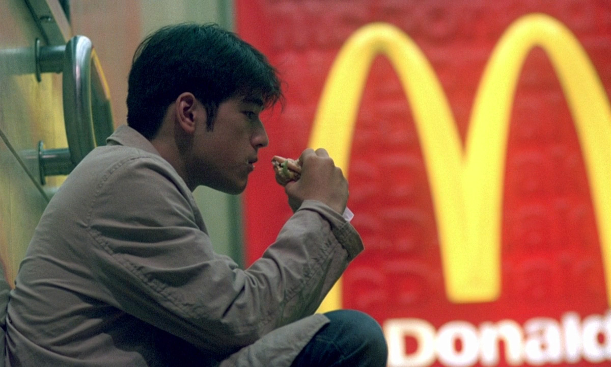
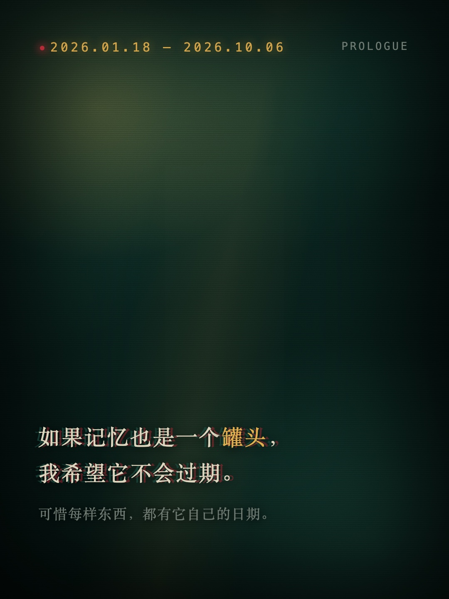
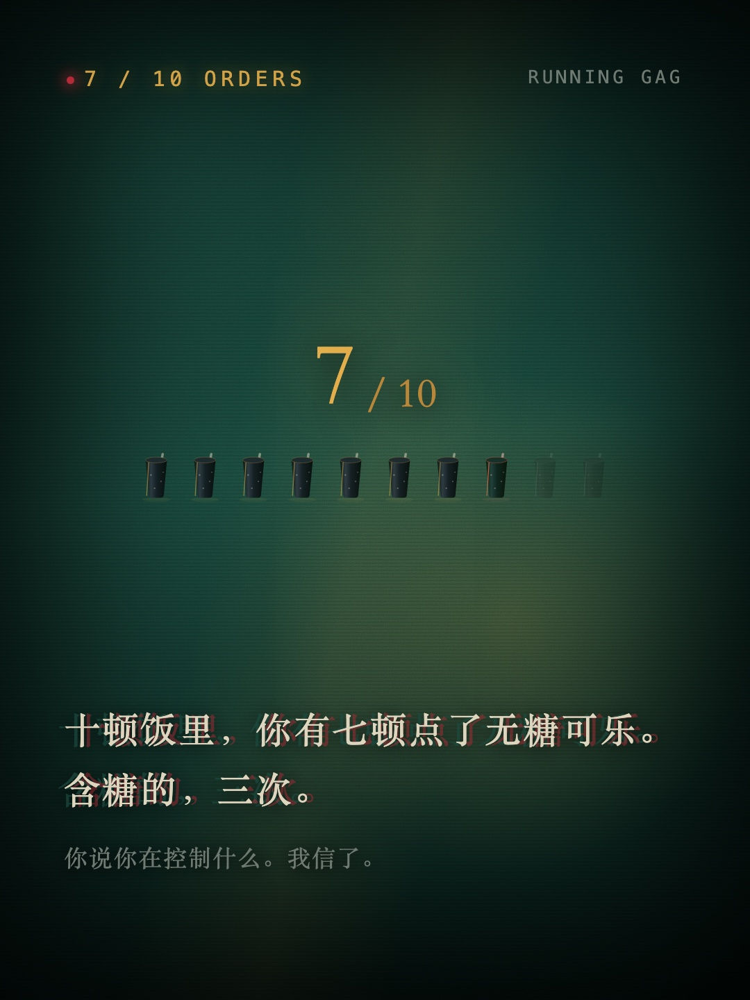
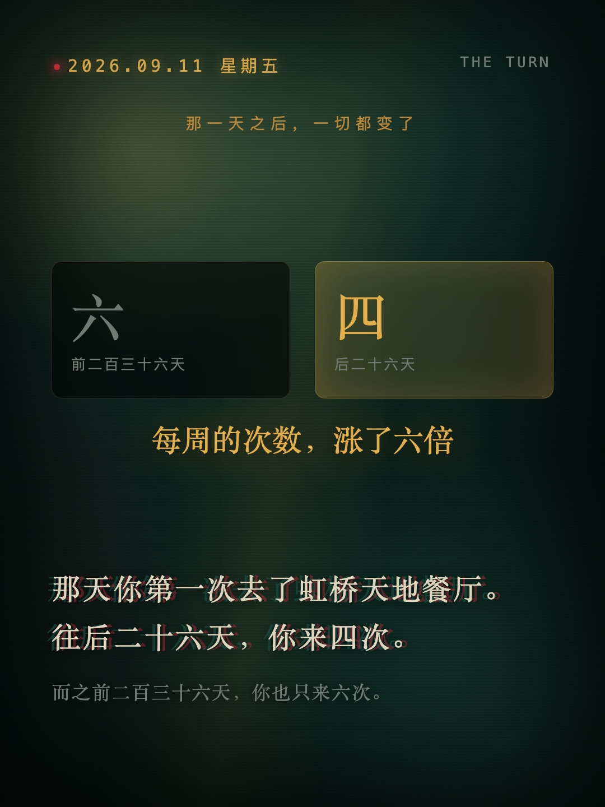

# 麦麦记忆罐头 · mcd-memory-can

> 如果记忆也是一个罐头，我希望它不会过期。
> 可惜你每一顿麦当劳的订单上，都印着精确到秒的日期。

把它装进罐头，拍成一部电影。

这是用**麦当劳官方 MCP** 拉取你自己的历史订单，再生成一套《重庆森林》质感的九幕图文长卷的小工具。
它不卖券、不算卡路里、不推荐你该吃什么 —— 它只做一件事：**把你已经吃过的那几顿饭，讲成一个故事。**

---

## 它长什么样

| 第一幕 · 序 | 第五幕 · 执念 | 第七幕 · 分水岭 |
|---|---|---|
|  |  |  |

每一幕都是 1080×1440 的竖图，可以直接发小红书；也可以整卷导出一张长图或一份 PDF。

九幕分别是：

| 幕 | 讲什么 |
|---|---|
| 01 序 | 你的第一条订单与最后一条订单，中间隔了多久 |
| 02 第一顿 | 第一次点的是什么，在哪，几点，星期几 |
| 03 跨度 | 从第一顿到今天，一共多少天 |
| 04 坐标 | 你去过几家门店，哪一家去得最多 |
| 05 执念 | 你重复点过最多次的那个组合 |
| 06 招牌菜 | 单品点单排行榜 |
| 07 分水岭 | 某一天之后，你的频率忽然变了 |
| 08 空窗 | 最长的那段没吃麦当劳的日子 |
| 09 尾声 | 把这一切收进一句话 |

**不是每个人都会有九幕。** 算不出来的那一幕会被整页丢掉 —— 数据里没有的东西，文案不会编。
所以有人拿到六页，有人拿到八页，这是对的。

---

## 三步跑起来

```bash
# 1. 拿到 McDonald's MCP 的 Token
#    打开 https://open.mcd.cn/mcp ，登录后激活 MCP，复制那串 Token

echo 'MCD_MCP_TOKEN=你的token' > .env && chmod 600 .env

# 2. 跑完全流程（读订单 → 算规律 → 排版 → 冲印成图）
bash run.sh

# 3. 看成品
open output/png/
```

想先看看长什么样、但还没有 Token？用样例数据离线跑：

```bash
python3 scripts/cards.py --demo --format cards
python3 scripts/render.py
```

`--demo` 全程不联网，用的是 `examples/demo-stories.json` 里那份**虚构**数据。

> **环境要求**：Python 3.9+，加上本机已有的 Chrome / Edge / Chromium 之一（用来把 HTML 冲印成 PNG）。
> 不需要 pip install 任何东西 —— 整个项目只用标准库。

---

## 数据从哪来，为什么它会越用越长

麦当劳的 `order-list` 接口**只返回最近 10 单**，官方固定上限，不支持分页，也不支持传时间范围。
这是接口本身的天花板，不是 bug。

所以这个项目做了一个小设计：

```
每次运行
   ├─ 把当次拿到的订单存进 data/snapshots/YYYY-MM-DD.json   ← 快照，永不覆盖
   └─ 与累积库 data/orders.json 按 order_id 合并去重          ← 你跑得越久，时间线越长
```

**第一天的报告只能讲 10 顿饭。半年后，可能就能讲 60 顿。**

想让时间线真的变长，就让它每天自动跑一次（脚本会自己处理去重，重复跑不会产生垃圾数据）：

```bash
bash install_headless.sh          # 装成 macOS 的 launchd 定时任务（每天两次）
bash install_headless.sh status   # 看状态
bash install_headless.sh uninstall
```

---

## 它不会做什么

这一条比上面所有功能都重要：

- **只读。** 整个项目不调用任何下单、支付、修改账户的接口。它读你的订单，然后就没有然后了。
- **不上传。** 没有服务器，没有埋点，没有第三方 API。你的订单只留在你自己的硬盘上。
- **不替你分享。** 图片生成在本地，发不发、发哪张，由你决定。

也正因为如此，仓库里**不应出现任何真实数据**：

```gitignore
.env          # Token
data/         # 你的真实订单
output/       # 你的真实成品图
```

这三行是仓库的默认配置。`assets/preview/` 里的展示图全部由 `examples/demo-stories.json`
那份虚构数据渲染而来 —— **README 里你能看到的每一张图，都不是任何人的真实消费记录。**

---

## 目录结构

```
mcd-memory-can/
├── run.sh                    # 一条命令跑完全流程
├── install_headless.sh       # 装成定时任务（macOS launchd / cron）
├── scripts/
│   ├── mcd_client.py         # 与麦当劳 MCP 通信的最小客户端
│   ├── fetch_orders.py       # 拉订单 + 快照 + 累积合并
│   ├── stories.py            # 从订单里算出九幕需要的每个数字
│   ├── cards.py              # 把数字排成 HTML（CSS 布光，零素材依赖）
│   ├── art.py                # 视觉层：光、颗粒、字体
│   └── render.py             # 暗房：用本机 Chrome 无头模式把 HTML 冲印成 PNG
├── templates/theme.css       # 重庆森林主题
├── assets/
│   ├── backgrounds/          # 八张实拍底图（可选，--mode photo 才用）
│   └── preview/              # README 展示图（样例数据渲染）
├── examples/demo-stories.json# 虚构样例数据
├── docs/tools.json           # 麦当劳 MCP 工具清单（离线查阅用）
└── data/                     # 你的真实数据（已被 gitignore）
```

---

## 为什么是「重庆森林」

因为这部片子讲的就是**会过期的东西**。

凤梨罐头的保质期是 1994 年 5 月 1 日。而你的订单里，每一行都带着一个精确到秒的时间戳 ——
那是真实发生过的、再也回不去的一顿饭。

技术上，这套视觉只用了七个颜色、三种字体、一个 CSS 布光系统，
不依赖任何设计软件和图片素材，`--mode art` 下零素材依赖，任何人 clone 下来都能跑出一样的质感。

---

## 常见问题

**Q：我只想看效果，不想给 Token。**
用 `--demo`。全程离线，用虚构数据渲染，成品和真实跑出来的一模一样。

**Q：报错说找不到 Chrome？**
`render.py` 会依次找 Chrome / Chromium / Edge / Brave。都没有的话，可以直接打开 `output/html/` 里的文件，用浏览器「打印 → 存为 PDF」。

**Q：订单只有 10 条，感觉不够。**
这是接口限制。挂上定时任务跑，累积库会一天天长起来。

**Q：为什么我的页面比别人少？**
因为算不出来的幕会被丢掉。数据不足时宁可少一页，也不编造。

---

## 关于本项目

为**麦当劳程序员创意开发大赛**而作。

数据来源：麦当劳官方 MCP（`https://open.mcd.cn/mcp`），仅使用 `order-list` 只读接口。

